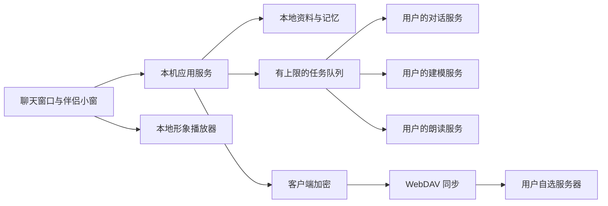

# NIRIA 技术方案

首版的实现重点是本地身份与记忆的连续性，以及单图生成素材的可用性。当前已从图像实验台推进到本地桌面开发预览，具体进度见 [开发状态](development-status.md)。

用户已确认产品范围。下面区分当前落地实现和后续设计；具体框架是开发过程的实现选择，开源许可证尚未确定。

## 桌面架构

最初建议优先验证 Tauri 2，但本机未提供 Rust 工具链。为复用已完成的 Node.js 服务并交付实际可运行的 Windows 窗口，当前采用 **Electron 45 + 原生 JavaScript 模块 + Canvas 2D / WebGL**，用 Node 内置 SQLite 持久化资料。未为了开发预览安装 Rust。

Electron 主进程负责本机服务和原生窗口。渲染进程关闭 Node 集成，启用 context isolation 和 sandbox；preload 只开放固定的窗口命令、布尔偏好状态和受限状态通知，不开放文件、Shell 或任意 URL 操作，也不接受任意窗口坐标。服务监听随机的 loopback 端口，并检查 Host、Origin 与会话令牌。

主窗口、小窗原生句柄、截图透明像素、收起/展开尺寸及渲染进程隔离已通过实际 Windows 测试。窗口创建后重新应用外部边界，修正高 DPI 下原生框架初始化造成的尺寸偏差；允许一个逻辑像素的取整差异，保存时保留此前相近值以防反复重启累积偏移。实际 Windows 测试已覆盖小窗显示保留主窗口焦点、最小化恢复、Alt+F4 隐藏、置顶切换、屏幕外找回和三次独立进程的状态恢复。实体多显示器切换、跨屏拖动与长时间置顶体验仍需人工验证。

`desktop/window-state.mjs` 管理设备独立的 `desktop.json` v1，校验有限坐标、尺寸和布尔值，限制读取大小，以临时文件和重命名保存。无法读写时显示简短提示；未知较新版本只读，避免降级覆盖。主窗口保存普通边界和最大化标记，跳过最小化坐标；小窗保存位置、显示、收起及置顶状态。退出时刷新偏好，退出过程的窗口隐藏不改写显示偏好。这份文件不属于伴侣资料、备份或远端同步。

`desktop/window-layout.mjs` 用 Electron 工作区的逻辑像素计算布局。恢复时选取重叠最多的显示器，没有重叠则选择邻近工作区，再夹到范围内；支持负坐标、任务栏偏移及小屏幕。小窗尺寸由收起状态确定，收起/展开保留右下角锚点；显示器新增、移除或范围变化后延迟合并修正。托盘可将小窗找回到鼠标所在屏幕。显示调用采用 `showInactive()`，恢复聊天先解除最小化再聚焦。

本机服务层负责资料、模型请求、受限任务调度、同步与备份加密，服务适配器只调用明确的接口。当前桌面开发预览复用受保护的 loopback HTTP 接口；未来是否改为全部 IPC 需要单独迁移验证。

当前桌面壳为 Electron，继续按实际窗口行为、安装包和设备验收收敛；浏览器预览只验证浏览器环境。

## 身份与资料

只有一个伴侣身份，修改外观或更换对话模型不会创建新身份。核心人格设定、相处习惯、关系经历与图像资产分开存储。

本地使用 SQLite 存储版本 3。`core/sqlite-state.mjs` 在同一事务保存消息、记忆、来源、删除标记、调用记录和独立形象表，只写入发生变化的实体；身份、设置、配额和冲突等其余字段保存在元数据行。`core/sync-storage.mjs` 将同步表头、记录正文、顺序、删除标记和指纹分开保存，未变化的正文不再随新增聊天重写。每个实体仍保留完整 JSON，兼容可选表情及引用字段。修改失败时资料表、来源索引、同步元数据及内存版本关系一起回滚。

旧的单行快照在一个事务中迁移并留下阻止旧版误读的标记；损坏或未知较新格式停止打开，不替换身份。备份与同步状态仍为 v1。已验证旧库、旧加密备份、冲突版本和实际 Windows 程序的重启升级流程，安装器覆盖安装仍待验证。当前仍全量载入/比较内存状态，形象没有独立资产分块，远端仍整包传输，详见 [存储与升级](storage.md)。

主窗口和小窗读取最近 120 条消息及全局最新用户 ID；`core/message-history.mjs` 在 SQLite 上按位置提供双向历史分页、字串搜索和锚点上下文，不经过模型。游标绑定身份、搜索条件及聊天版本；消息变化后旧游标失效，事务失败同时回滚版本。界面清除过期结果、取消旧搜索并拒绝晚到响应。记忆来源按需读取且检查当前修订/正文哈希，因此较早来源不依赖窗口中的最近消息集合。

0.13.0 的窗口状态另用 `memories=none` 读取记忆版本及数量摘要；`core/memory-list.mjs` 在 SQLite 上按位置返回每页 60 条记忆，支持字串、类型和实际有效状态的组合筛选。来源/纠正检查的状态缓存由 SQLite 标量函数参与查询，消息、记忆、冲突和期限变化后重建。游标绑定身份、筛选及当前版本，事务失败恢复版本；界面按锚点重载较早页，关闭时清除结果。实际引用的记忆通过独立只读接口核对回复上下文和记忆修订/哈希，改变或过期后不显示旧正文。有限窗口读取没有改变核心的全量状态处理，同步仍上传完整加密对象。

服务配置默认仅驻留本机进程。Windows 桌面版可按服务选择安全记住，使用 Electron 45 `safeStorage` 异步接口执行系统加密，密文单独写入 `credentials.sqlite`。配对码有独立开关，普通伴侣数据库、备份和调用记录均不携带密钥。系统保护不可用时不启用明文回退；损坏配置不自动连接，界面提示重新填写。本机伴侣数据库当前未加密。

配置状态只公开模型、地址、是否有密钥和保存状态，不返回密钥。复用密钥须显式选择并匹配完整 API 根地址，WebDAV 同时匹配账号；更换地址不沿用旧秘密。图片配置有运行时版本 ID，生成请求绑定用户确认时的版本。

记忆引用来源消息及修订号。构造模型请求前检查消息是否仍有效、记忆是否被纠正或遗忘，以及该条目是否允许发送。后台整理只提交基于当前有效来源的结果，避免旧任务在用户删除消息之后把资料重新写回。

记忆编辑可单独修改类型和期限；元数据修改保留来源与确认状态，正文修改才成为手动确认资料。日期输入按设备时区转换为统一时间，过期记录不参与上下文，进行中的回复提交前也重新检查有效期。表单提交核对打开时的完整原值，防止同修订的其他正文被覆盖。

`core/memory-provenance.mjs` 统一当前来源与纠正前关联。真正改变正文时，把有效性依赖移到 `supersededSources`；旧版本消息及回复链退出模型上下文，已有旧衍生记忆停用，整理前和结果保存前都检查是否仍允许使用。关联只保存 ID、修订和哈希，用于追溯、独立权限及显式遗忘，不保留旧正文副本。过期或删除纠正不能复活旧来源，新版本来源仍可使用。旧备份恢复保留本机已有纠正和同一同步空间的对应版本关系。

`core/forget-preview.mjs` 生成带版本摘要的分页影响清单，用户明确确认后才遗忘。`core/deletion-cascade.mjs` 统一本机、重启、备份与同步的删除传播：沿显式来源和回复关系处理，包括冲突叶节点及本机保留的已删除关系；不根据文字相似性扩大删除。普通删除停用衍生记忆，遗忘清空相关记忆正文；未读到的离线衍生记录以后再合并处理。计划生成后相关资料改变即拒绝旧确认，关闭页面取消读取并清除片段。

## 形象生成与播放

原型先验证少量目标状态：原始、闭眼、微笑、疑惑和害羞。每次只申请一个状态，保持参考图身份、姿态、比例与背景，返回后由用户确认。

现有播放器采用全帧素材和整体缩放，能用于观察明显的一致性问题。主界面、小窗与实验台保持素材比例，多余区域透明。闭眼帧只与原始表情混合，避免把原始表情的闭眼帧错误混入其他表情。局部形变及每种表情的独立闭眼素材仍待实现。

0.12.0 的 `prototype/public/frame-blender.js` 使用一张复用的透明 Canvas 混合预乘颜色与透明度：原图权重为 `1-t`，目标权重为 `t`，中间帧通过 `lighter` 合成，端点直接绘制对应素材。它替代原来的“原图加目标图覆盖”，避免目标透明区域透出旧轮廓。混合结果再共用呼吸变换，不改变素材字节、对齐或模型请求。实验台隐藏时不安排下一绘制帧，返回时恢复；退出页面释放暂存画布。

导入时在本地缩小采样，检查空白、纯色、原始像素尺寸、对比度、透明覆盖与贴边。尺寸由解码器及 PNG 文件头分别限制在 2000 万像素以内。它没有人物或面部模型，不能把像素检查报告当成人数、遮挡或身份验收。实验台重开会载入已保存的原图与素材；未保存的编辑仍留在页面内存，恢复时检查的是已保存画布，不能据此恢复最初输入图的清晰度。

新目标帧等比适配到 1024 × 1536，在独立本机 Worker 中通过 96 × 144 的亮度/透明度有向梯度比较轮廓，多分辨率搜索小幅平移与统一缩放。归一化相关分数至少 0.88 且改善至少 0.08 时建议修正，否则保持服务返回的位置。搜索不包含旋转或非刚性变形。用户可撤销建议或叠加原图对照；最终采用的是所选帧，比较用的合成画面不进入保存素材。比较失败不会重试模型，生成确认同时绑定参考图对象与图片连接版本。

0.14.0 的 `image-background.js` 提供有界的四邻域边缘连通处理：从稳定的近似纯色边缘向内移除背景，保留封闭同色细节，处理半透明边缘并减少底色污染；复杂、空白或移除过多时保留原素材。它不执行人物语义分割。`background-editor.js` 逐张预览全部已有素材，全部兼容且至少一张有变化才允许采用，可随时恢复原背景。

形象只增加可选 `background: { version: 1, mode: "edge-connected" }`，原始 PNG 字节不变。各窗口由 `prepareAvatarFrame` 在本机 1024 × 1536 画布和 Worker 上准备显示帧；取消、超时、同步发送失败和换图均清理对应任务，晚到结果不能恢复已移除的形象。可读取帧中任一背景处理失败时整组回到原素材，按素材标识提示一次；实验台保留状态提示并禁止用不完整的参考图生成。没有 Worker 时使用相同算法同步处理。原图无法解码仍显示导入错误，不通过背景回退掩盖坏图。

启用背景处理的生成请求使用预览后的透明参考图，采用时保存经过等比适配及用户所选对齐的原始动作，显示转换不覆盖素材。保存、SQLite、备份与同步都保留显示设置，不缓存处理后的副本；恢复背景只移除设置。旧客户端可能不显示或在再次保存时丢弃设置，使用时需统一版本。

主窗口与小窗共用播放器，支持八秒的微笑、疑惑、害羞状态与到期待机。对话系统提示只列出已采用素材的表情名称；同次普通文本回复通过末行标记携带名称，不使用额外分类请求或专用模型参数。有效标记在写入消息前剥离，正文用于后续上下文与朗读；可选表情元数据绑定素材摘要及回复完成时间，保存在消息中并随加密备份和同步传递。旧快照缺少该字段仍有效，过期和素材不匹配的表情不重播。新用户消息、删除、冲突和缺失素材回到原图；减少动态效果时用静止帧及到期定时器。

本机服务在资料事务完成后通过令牌验证的 HTTP 事件流通知窗口失效。事件只有固定的空对象，不包含资料；窗口再读取受保护的快照。通知合并并限制连接数和积压，客户端串行刷新以免旧快照覆盖新状态，断线后重连并保留低频轮询。这是本机界面更新，不替代远端 WebDAV 同步。

全图位置修正仍需真实素材评估；局部配准、固定机位重新编辑与部位素材是后续方向。是否需要网格变形由实测决定，不预先绑定 Cubism 或其许可。

0.18.0 同时接入用户追加的 Live2D 输入链路。`live2d-import.js` 仅收集所选模型声明的本地资源，`live2d-avatar.js` 校验版本化包和用户选择的映射；`live2d-assets.js` 提供受限读取与可释放 Blob URL。`AvatarPlayer` 按形象类型交给图片播放器或 `Live2DPlayer`，两窗口共用。Live2D 生命周期已用二维替身验证取消、迟到载入、换图、表情到期、首次绘制失败和 context 丢失；0.19.0 的工厂已接入本地 Cubism SDK for Web 5 R5。Core 内嵌 WebAssembly 就绪后再载入 Framework，创建独立的 WebGL、纹理、shader、动作、表情与物理实例。官方 Haru 模型已验证实际动作像素、表情、减少动态效果、双窗口与 SQLite 重启。

`live2d-dialog.js` 管理文件夹选择、多模型选择、资源摘要和映射；关闭或形象依据变化会取消并使预览失效。0.19.0 在纹理解码、shader 编译及可见首帧成功后开放采用；服务端另在无 require、process、文件或网络能力的 VM 中使用固定官方 Core 检查 moc。`core/live2d-adoption.mjs` 核对伴侣 ID 与形象摘要后，才允许在同一资料事务替换。SQLite、备份与同步沿用形象字段，支持结构资料和冲突版本；播放文件与 shader 随项目固定，没有 CDN 回退；CSP 仅为 WebAssembly 增加 wasm-unsafe-eval。第三方模型兼容与正式发行许可仍需确认，见 [Live2D 记录](live2d.md)。

## 模型与任务

对话服务采用可配置 API 根地址、模型名称及密钥。对话、图片编辑和朗读有独立能力描述及连接测试。不要把“兼容某接口”扩展为“所有参数均支持”。

已实现单个进行中的对话请求、超时取消、默认每日最多八次的自动记忆整理，以及默认关闭的主动问候。独立持久计数避免调用日志截断后重置每日预算。记忆整理只发送本轮用户消息，结果带来源修订、时间、确认状态和可选有效期，过期或失效条目不参与回复。

0.18.0 在问候发起前及回复落盘前检查关怀设置、静默时段、活动间隔和最近用户消息。聊天框聚焦/输入通过 `chat-activity.js` 合并为每秒至多一次本机空通知，不传送草稿或保存活动；只取消主动问候，普通聊天继续。设置变化、用户输入或进入静默时段后，晚到的问候不写入正文，已发起尝试仍计入每日上限。页面离开取消活动通知，不在空闲页面重试。

构造上下文时限制消息与记忆文本总量。先过滤删除、失效、冲突、过期或无模型权限的条目，再通过本地中文分词和英文归一化进行词语相关性排序，优先话题匹配，补充已确认与近期资料。不请求外部 embedding，没有深层语义召回。实际请求记录引用的 ID、修订、哈希与召回原因。

`core/chat-service.mjs` 的 `previewContext` 将非空草稿作为临时用户消息加入只读投影，再使用实际发送共用的 `buildContext`，因此条数与字数预算都包含草稿。临时消息不落盘，也不作为已记录来源返回。空草稿只查看当前选择，不假设多出一条消息。预览不调用服务；实际发送仍重新构建上下文。

`prototype/public/context-review.js` 共用草稿预览和实际引用的对话框。服务端响应携带 `previewBasis`，绑定身份、消息/记忆修订、模型权限、连接版本、形象标识和原始草稿；界面与当前摘要比对，窗口尚未收到变更通知时先刷新，避免显示旧正文。预览及引用响应的 `validUntil` 是实际可用记忆的最早期限，仅作为响应元数据，不写入消息引用。界面还依据记忆摘要安排到期核对，期限到达先清除内容；已经到期的响应丢弃。输入变化立即清空，延迟 160ms 重新读取；关闭、取消和离开页面中止请求，序号检查拒绝晚到结果，并支持快速重开与手动重新核对。

输入框维护本机修改序号。发送成功只有在序号及正文都与提交时一致时才清空原草稿；等待时新写或改回相同文字也保留。失败和重新回复均保留草稿，重试不新增用户消息。这些修改不改变存储版本 3、备份或同步 v1。

0.17.0 的重新回复先在临时状态中删除旧回复及停用衍生记忆，使用同一套删除关系构造新请求，本机原记录继续可读。提交前再次核对来源、原回复完整内容及最近用户消息；有变化则拒绝覆盖。新回复完成、旧回复删除标记及衍生停用在同一资料/同步事务提交，失败回滚，错误记录说明原回复保留。重启遇到未完成请求仍只标记失败，保留原回复，不重新调用服务。用户在等待时的删除、编辑和遗忘优先，不恢复任何旧副本。

来源被编辑、删除、纠正或权限改变后，旧回复不能提交；过时的整理结果不能提交，即使新纠正未进入该轮的记忆召回范围，也会重新核对原消息是否仍可使用。手动纠正记忆作为明确资料解除旧来源依赖，保留追溯关联。禁止模型发送的记忆连同其原始对话、关联回复均不加入上下文。

调用记录区分返回、失败和未知结果。不自动重新提交超时或失败的请求。图片任务仍独立串行处理。

原型只实现一次图片编辑的明确确认，不自动调用语言模型做质量判定。将来加入自动质量检查时，所需额外服务调用也要纳入请求预览和上限。

## 同步与恢复

WebDAV 服务端只承担加密对象存储。客户端负责身份、密钥、冲突处理和恢复，不依赖服务端理解记忆内容。

创建配对时即从当前资料生成完整同步版本图和指纹，连同本机同步表头原子保存，成功后才公布配对码；失败保留未配对状态并清理新生成的内存密钥。这样刚配对且尚无后续修改时也能导出可恢复的备份，不改变协议格式。

当前同步采用单个加密状态对象，通过强 ETag 条件更新提交。对象含实体修订图和当前叶节点正文，历史节点不保留旧正文，避免遗忘后仍在历史记录中携带秘密。原先建议的独立不可变记录和资产对象仍是后续增量方向，当前整包传输有 100 MB 上限。

已用本机 WebDAV 测试服务器验证集合操作、上传下载、错误条件被拒绝、有效条件更新与并发 412 重读。Nextcloud 实测仍未完成，不宣称已经兼容所有 WebDAV。完整细节见 [同步协议](sync.md)。

聊天新增记录按稳定 ID 去重合并；互相矛盾的人格或记忆修订作为冲突保留。删除或遗忘记录需要传播，且不保存被遗忘的正文。同步合并与旧备份恢复时，应先对账删除状态，再允许记录进入模型请求。

完整备份已使用 Node crypto 的 scrypt（N=32768、r=8、p=1）和 AES-256-GCM，随机 16 字节盐与 12 字节 nonce，固定版本 AAD。恢复验证认证标签与数据结构，本机删除标记优先于旧备份。口令不持久保存。

同步现已使用独立随机 256 位密钥、配对码、AES-256-GCM 对象封装和修订图冲突版本。WebDAV 登录资料与配对密钥在本机进程使用，可选择以系统加密密文单独落盘；加密伴侣备份包含修订图但不含密钥。

`core/sync-pairing.mjs` 管理配对码和不含密钥的标识，`core/sync-rotation.mjs` 管理准备、确认、有条件重加密以及中断后的只读核对。准备时用户先保存含新旧配对码的恢复文件；执行时保存不含秘密的换钥标记，并在写入远端前清除本机保存的旧码。结果未知就暂停上传，重启后用已保存配对码只读验证远端，再事务合并本机并清除标记。凭据保存失败与远端结果分开显示；已存自动开关同步关闭，避免重启意外恢复上传。

换钥仍是共享密钥方案，所有其他设备需要更新配对码。按设备发放/封装密钥和单设备撤销协议尚未实现，丢失设备的 WebDAV 登录权限需要在服务端撤销；换钥不清除旧副本，也不消除服务端回放风险。密文之外的文件名、大小与目录结构仍可观察，不能以正文加密宣称隐藏全部元数据。

朗读服务独立配置 `/audio/speech`，要求 WAV 响应，只发送选中的回复文本。自动播放默认关闭，试听、手动和自动请求都计入持久的每日上限；失败不重试，音频不进入数据库或同步。

完整伴侣备份与原型的图片素材包是两种不同产物。前者需要加密、版本迁移与恢复测试；后者只是用于验证图像链路的可导入 JSON。

## 实施次序

1. 完成图像原型的真实服务测试和视觉验收，选定素材格式与播放方式。
2. 实现 Windows 窗口、单一身份、本地聊天、模型配置及数据持久化。
3. 加入长期记忆、来源更新、遗忘规则、可选朗读和主动关心。
4. 实现客户端加密、Nextcloud 同步、冲突处理和完整备份恢复。
5. 验证安装、升级、两台 Windows 互通与故障降级，发布小范围测试版。

## 一手参考

- [Tauri 窗口配置](https://v2.tauri.app/reference/config/#windowconfig)
- [Tauri 环境要求](https://v2.tauri.app/start/prerequisites/)
- [OpenAI 图片编辑接口](https://developers.openai.com/api/reference/resources/images/methods/edit)
- [Nextcloud WebDAV 基础操作](https://docs.nextcloud.com/server/stable/developer_manual/client_apis/WebDAV/basic.html)
- [WebDAV RFC 4918](https://www.rfc-editor.org/rfc/rfc4918.html)
